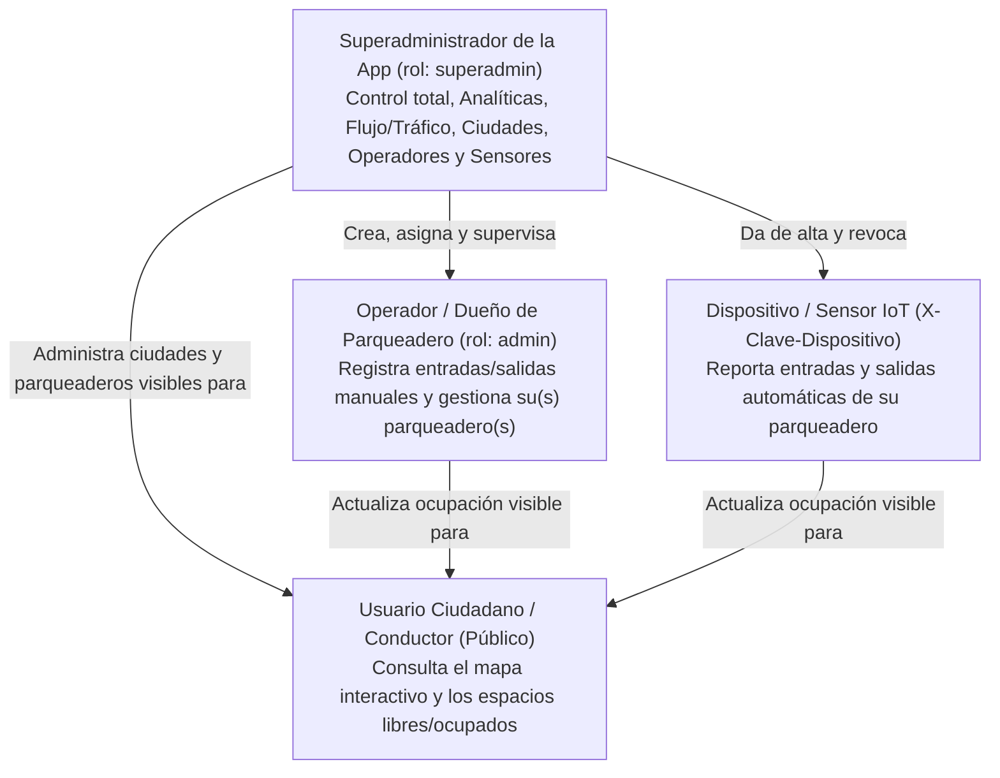

# 01 — Especificación Funcional y Matriz de Roles (RBAC)

## 1. Visión y alcance funcional

La plataforma resuelve el problema de incertidumbre de estacionamiento urbano en Cuenca (y escalable a todo el Ecuador) mostrando en tiempo real los espacios disponibles y ocupados de cada parqueadero, alimentada tanto por personal en sitio (dueños de parqueaderos / guardias de seguridad) como por sensores automáticos de acceso, y gobernada desde una consola central de Superadministración y Analíticas.

---

## 2. Jerarquía de actores y perfiles

### 2.1. Usuario Ciudadano (`Público`, sin cuenta)
- Visualiza el mapa interactivo por ciudad (`/`).
- Consulta al instante cuántos espacios **disponibles** y **ocupados** tiene cada parqueadero activo.
- No puede modificar ningún dato.

### 2.2. Dispositivo o Sensor de Acceso (`Dispositivo`, cabecera `X-Clave-Dispositivo`)
- Representa una barrera vehicular, espira inductiva o lector de acceso instalado en un parqueadero.
- Se autentica mediante una clave de alta entropía cuyo hash SHA-256 está vinculado a un único `parqueo_id`.
- Solo puede registrar entradas y salidas de su propio parqueadero; no puede consultar ni alterar otros parqueaderos.

### 2.3. Operador / Dueño de Parqueadero / Seguridad (`Administrador`, `rol = "admin"`)
- Corresponde a las personas encargadas de poblar y mantener al día la ocupación de los parqueaderos (propietarios, administradores de estacionamiento o guardias de garita).
- Accede al panel operativo (`/admin`).
- **Alcance configurable:**
  - **Con `parqueo_id` asignado** (p. ej. `guardia_calderon`): únicamente ve y puede operar su parqueadero asignado. Cualquier intento de operar otro parqueadero o crear uno nuevo devuelve `403 Forbidden`.
  - **Sin `parqueo_id` (`null`, operador multiparqueo)**: puede operar todos los parqueaderos registrados.

### 2.4. Administrador de la Aplicación (`Superadministrador`, `rol = "superadmin"`)
- Perfil de máxima autoridad sobre la plataforma (`/superadmin`).
- Hereda todos los permisos operativos de `/api/admin` y posee acceso exclusivo a `/api/superadmin`:
  - **Analíticas, Flujo y Tráfico:** KPIs de ocupación global, gráfico horario de entradas vs. salidas, identificación de hora pico, desglose de origen (`dispositivo` vs `manual`), tabla de saturación e índice de rotación por parqueadero, y bitácora en tiempo real de los últimos movimientos.
  - **Gestión de Operadores y Dueños:** crear cuentas (`admin` o `superadmin`), asignarlas a un parqueadero específico o general, y activarlas/desactivarlas.
  - **Control de Ciudades e Infraestructura IoT:** dar de alta nuevas ciudades del país, crear claves para nuevos sensores y revocar o reactivar dispositivos existentes.

---

## 3. Matriz de control de acceso (RBAC)

| Operación / Recurso | Público | Sensor IoT | Operador Asignado (`admin` + `parqueo_id`) | Operador General (`admin`) | Superadmin (`superadmin`) |
| :--- | :---: | :---: | :---: | :---: | :---: |
| Ver ciudades y parqueaderos activos (`/api/parqueos`) | Sí | Sí | Sí | Sí | Sí |
| Registrar movimiento por sensor (`/api/dispositivos/movimientos`) | No | Solo su parqueo | No | No | No |
| Listar parqueaderos en panel (`/api/admin/parqueos`) | No | No | Solo su parqueo | Todos | Todos |
| Registrar entrada/salida manual (`/api/admin/parqueos/{id}/movimientos`) | No | No | Solo su parqueo | Todos | Todos |
| Editar datos/capacidad de parqueo (`PATCH /api/admin/parqueos/{id}`) | No | No | Solo su parqueo | Todos | Todos |
| Crear nuevo parqueadero (`POST /api/admin/parqueos`) | No | No | No (`403`) | Sí | Sí |
| Ver analíticas, flujo horario y tráfico (`/api/superadmin/analiticas`) | No | No | No (`403`) | No (`403`) | **Sí** |
| Crear y editar ciudades (`/api/superadmin/ciudades`) | No | No | No (`403`) | No (`403`) | **Sí** |
| Crear, asignar y desactivar operadores (`/api/superadmin/operadores`) | No | No | No (`403`) | No (`403`) | **Sí** |
| Auditar y revocar sensores IoT (`/api/superadmin/dispositivos`) | No | No | No (`403`) | No (`403`) | **Sí** |

---

## 4. Reglas de negocio e invariantes (`RN`)

- **`RN-01` (Ocupación derivada de eventos):** La ocupación de un parqueadero se calcula siempre como $\text{entradas} - \text{salidas}$. No existe columna mutable de ocupación.
- **`RN-02` (Límites de capacidad):** Para todo parqueadero y en todo instante se cumple $0 \le \text{ocupados} \le \text{capacidad}$, tanto para registros manuales como para sensores, incluso bajo concurrencia.
- **`RN-03` (Reducción segura de capacidad):** No se permite reducir la `capacidad` de un parqueadero a un número menor que los vehículos actualmente dentro (`409 Conflict`).
- **`RN-04` (Parqueadero inactivo):** Un parqueadero con `activo = False` se oculta del mapa público (`GET /api/parqueos` y `GET /api/parqueos/{id}`) y rechaza nuevos movimientos (`409 Conflict`), pero conserva intacto todo su historial para las analíticas.
- **`RN-05` (Aislamiento de sensor):** Una clave `X-Clave-Dispositivo` identifica inequívocamente a un único dispositivo y su `parqueo_id`. Si el dispositivo se desactiva (`activo = False`), sus peticiones son rechazadas de inmediato (`401 Unauthorized`).
- **`RN-06` (Aislamiento de operador asignado):** Un operador con `rol = "admin"` y `parqueo_id != null` solo puede ver, editar y registrar movimientos en ese parqueadero (`403 Forbidden` en cualquier otro).
- **`RN-07` (Protección contra auto-bloqueo de Superadmin):** Un `superadmin` no puede desactivar su propia cuenta ni degradar su propio rol (`409 Conflict`).
- **`RN-08` (Escalabilidad por datos):** Agregar una ciudad o un parqueadero no requiere ningún cambio de código ni redespliegue en backend ni en frontend.
