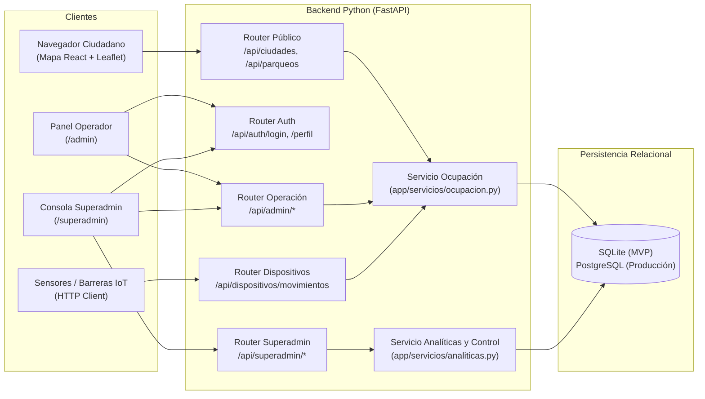
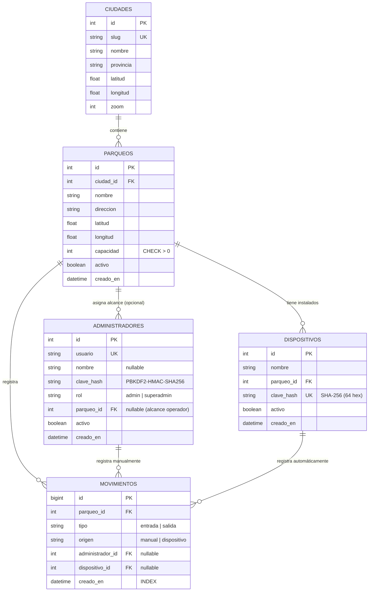

# 02 — Especificación de Arquitectura y Modelo de Datos

## 1. Arquitectura general del sistema

---

## 2. Diagrama Entidad-Relación (ERD)

Definido en [`backend/app/models.py`](../backend/app/models.py):

---

## 3. Cálculo de ocupación y escritura atómica

### 3.1. Subconsulta correlacionada (`ocupacion_de`)
En [`app/servicios/ocupacion.py`](../backend/app/servicios/ocupacion.py), la ocupación se define como:

$$\text{ocupados}(p) = \text{COALESCE}\!\left(\sum_{m \in \text{movimientos}(p)} \begin{cases} +1 & \text{si } m.\text{tipo} = \text{'entrada'} \\ -1 & \text{si } m.\text{tipo} = \text{'salida'} \end{cases},\ 0\right)$$

Gracias al índice compuesto `ix_movimientos_parqueo_tipo (parqueo_id, tipo)`, el motor de base de datos resuelve esta suma con un *Index-Only Scan* sin leer el resto de columnas de la tabla.

### 3.2. Prevención de condiciones de carrera
Para impedir que dos peticiones concurrentes sobrepasen la capacidad o dejen la ocupación en negativo:
1. Se ejecuta `SELECT ... FROM parqueos WHERE id = :id FOR UPDATE` (`_bloquear_parqueo`), que serializa las transacciones sobre un mismo parqueo en PostgreSQL.
2. El movimiento se inserta mediante un `INSERT INTO movimientos (...) SELECT ... WHERE <regla>` atómico:
   - Si `tipo == 'entrada'`, la condición `WHERE` exige `ocupacion_de(parqueo_id) < capacidad`.
   - Si `tipo == 'salida'`, la condición `WHERE` exige `ocupacion_de(parqueo_id) > 0`.
3. Si `resultado.rowcount != 1`, se hace `rollback()` y se lanza `Conflicto` (`HTTP 409`). En SQLite, donde `INSERT` adquiere el bloqueo de escritura antes de evaluar su `SELECT`, esto garantiza atomicidad estricta sin ventanas TOCTOU (*Time-Of-Check to Time-Of-Use*).

---

## 4. Diseño de seguridad

Implementado en [`backend/app/seguridad.py`](../backend/app/seguridad.py) y [`backend/app/dependencias.py`](../backend/app/dependencias.py):

1. **Contraseñas humanas (`administradores.clave_hash`):**
   - Algoritmo `PBKDF2-HMAC-SHA256` con sal aleatoria de 16 bytes y `600,000` iteraciones (recomendación OWASP), comparadas en tiempo constante con `hmac.compare_digest`.
   - Cuando el usuario enviado en `/api/auth/login` no existe, igual se ejecuta `verificar_clave` contra `hash_ficticio()` para impedir la enumeración de usuarios por tiempos de respuesta.
2. **Tokens de sesión JWT:**
   - Firmados con `HS256`, contienen `sub` (ID de la cuenta), `rol` (`admin` | `superadmin`), `iat` y `exp`.
   - En cada petición protegida (`requiere_admin` / `requiere_superadmin`), además de verificar la firma y expiración del JWT, se consulta la fila `Administrador` en la base de datos para que desactivar una cuenta o revocar su rol tenga efecto inmediato.
3. **Claves de sensores IoT (`dispositivos.clave_hash`):**
   - Generadas con `secrets.token_urlsafe(32)` (256 bits de entropía).
   - Se almacena únicamente su resumen `SHA-256` indexado (`UNIQUE`), y la clave en texto claro solo se devuelve en la respuesta de creación (`201 Created`).
4. **Guardias de producción (`Settings._proteger_produccion`):**
   - Si `ENTORNO=produccion`, la aplicación se niega a arrancar si `JWT_SECRETO` conserva el valor por defecto de desarrollo o si `CARGAR_DATOS_EJEMPLO=true`.
